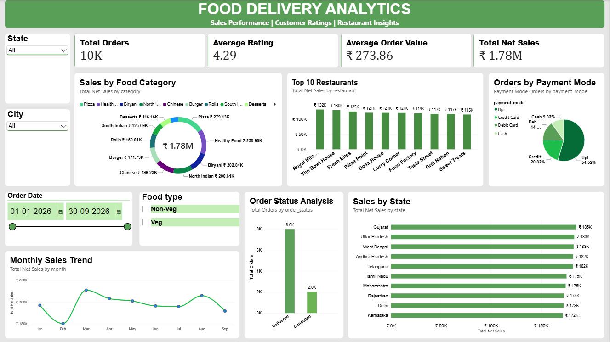

🍔 Food Delivery Analytics

📌 Project Overview
Food Delivery Analytics is a data analytics project focused on exploring food delivery data to understand order patterns, customer behavior, restaurant performance, and delivery operations. The project demonstrates practical data analysis skills and the use of data to support business decisions.

🎯 Project Objectives
- Analyze food delivery order trends and patterns.
- Understand customer ordering behavior.
- Evaluate restaurant and delivery performance.
- Identify operational issues and opportunities for improvement.
- Generate insights to support data-driven decisions.

🛠️ Tools & Technologies
- Python – Data cleaning and exploratory data analysis
- Pandas – Data manipulation and transformation
- SQL – Data querying and analysis
- Power BI – Dashboard development and visualization

🔍 Project Workflow
1. Data collection and inspection
2. Data cleaning and preprocessing
3. Exploratory data analysis
4. SQL-based analysis and business queries
5. Visualization and dashboard development
6. Insights and recommendations

📊 Key Business Questions
- How do order volumes change over time?
- Which restaurants or categories perform best?
- What is the average order value?
- How efficiently are orders being delivered?
- Which factors may contribute to delayed deliveries?
- What opportunities exist to improve customer experience?

📸 Dashboard Preview

📁 Project Structure

Food-Delivery-Analytics/
├── data/
├── Python/
├── SQL/
├── PowerBI/
├── Screenshots/
└── README.md

Business Value
This project demonstrates how data analysis can help businesses monitor performance, understand customer trends, identify operational inefficiencies, and make informed decisions.

👨‍💻 Author
Suhail Shaik

Aspiring Data Analyst | SQL | Python | Power BI | Data Analytics

- GitHub: [codersuhail66](https://github.com/codersuhail66)
- LinkedIn: [Suhail Shaik](https://linkedin.com/in/suhailshaik-ai)